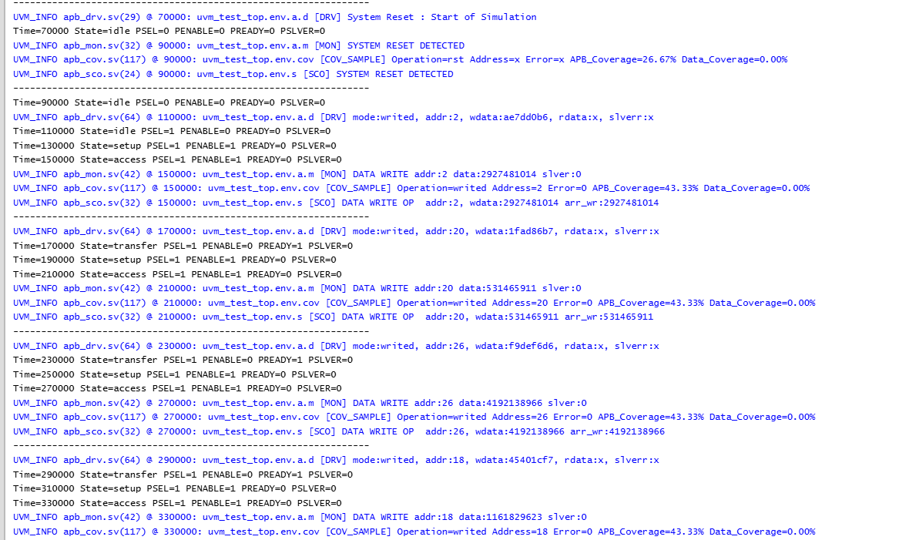
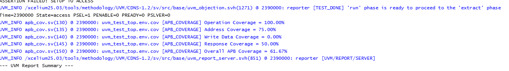
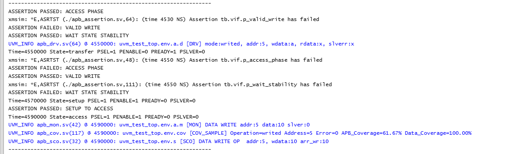
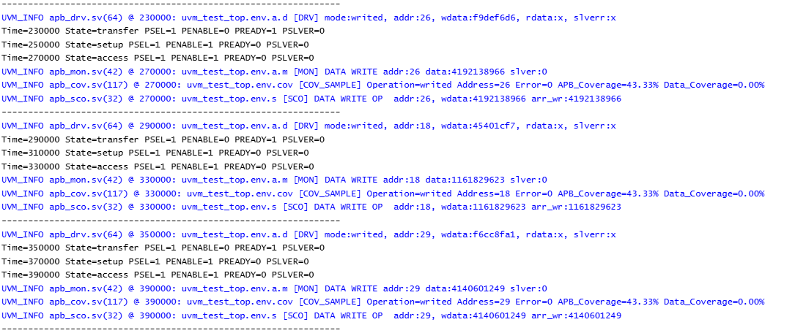
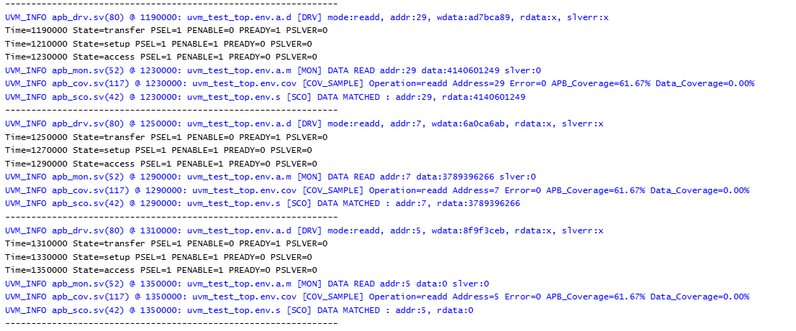

# APB RAM Verification using SystemVerilog and UVM

## Project Overview

This project verifies a simple APB RAM slave using SystemVerilog and the
Universal Verification Methodology (UVM). The testbench generates APB
read, write, and reset transactions, drives them to the DUT, observes
the bus activity, checks expected behavior, and collects functional
coverage.

The repository is intended as a hands-on Design Verification project
demonstrating transaction-based verification, reusable UVM components,
checking, coverage, and assertion-based protocol checks.

## DUT Overview

The DUT is a memory-mapped APB RAM slave with the following project
configuration:

  Item                  Configuration
  --------------------- --------------------------------------------
  Interface             APB-style slave interface
  Address input         32 bits
  Write data            32 bits
  Read data             32 bits
  Memory depth          32 locations
  Memory organization   32 words × 32 bits
  Operations            Read, write, reset
  Response signals      `PREADY`, `PSLVERR`
  Address range         `0` to `31` (word index)
  Reset                 Active-low, synchronous in the current RTL

**Addressing note:** The current RTL uses `paddr` directly as the memory
array index. Therefore, addresses `0` through `31` are valid word
indices; this is not a byte-addressed APB memory map.

## Verification Architecture

The testbench follows a UVM layered architecture:

-   **Test:** Creates/configures the environment and starts the selected
    virtual or regular sequence.
-   **Environment:** Instantiates the APB agent, scoreboard, and
    coverage subscriber.
-   **Agent:** Groups the sequencer, driver, and monitor.
-   **Sequence:** Creates APB transaction items such as read, write, and
    reset.
-   **Sequencer:** Supplies sequence items to the driver.
-   **Driver:** Converts sequence items into pin-level APB activity
    through the virtual interface.
-   **Monitor:** Samples APB interface activity and publishes observed
    transactions through an analysis port.
-   **Scoreboard:** Checks observed transactions and expected read/write
    behavior.
-   **Coverage subscriber:** Samples observed transactions and measures
    functional coverage.

The monitor analysis port is connected to both the scoreboard and
coverage subscriber.

## Transaction Flow

1.  A test starts a sequence.
2.  The sequence creates and randomizes or assigns a transaction.
3.  The sequencer provides the transaction to the driver.
4.  The driver drives the APB interface.
5.  The DUT responds through `PREADY`, `PRDATA`, and `PSLVERR`.
6.  The monitor observes the bus and reconstructs a transaction.
7.  The scoreboard checks the observed behavior.
8.  The coverage subscriber samples operation, address, response, and
    write-data categories.

## APB Transfer Phases

A normal APB transfer has three phases:

1.  **IDLE:** `PSEL=0`, `PENABLE=0`.
2.  **SETUP:** `PSEL=1`, `PENABLE=0`; address and control information
    are presented.
3.  **ACCESS:** `PSEL=1`, `PENABLE=1`; the slave completes the transfer
    when `PREADY=1`.

For a wait-state-capable APB slave, ACCESS can be extended while
`PREADY=0`, and the master holds the transfer control and data stable.
The current project DUT is a simplified implementation; verify the exact
wait-state behavior against the RTL and driver before claiming full APB
wait-state compliance.

## Verification Scenarios

The transaction types and scenarios represented in the project include:

-   Reset operation.
-   Valid write to an address in the range `0`--`31`.
-   Valid read from an address in the range `0`--`31`.
-   Invalid write using an address outside the implemented range.
-   Invalid read using an address outside the implemented range.
-   Repeated and randomized read/write activity, depending on the
    enabled sequences.

## Functional Coverage

The functional coverage model is intended to measure:

-   Operation type: write, read, reset.
-   Address categories: minimum, middle, maximum, invalid.
-   Response: successful response and error response.
-   Write-data patterns: zero, all ones, alternating patterns, selected
    small values, and other values.
-   Relevant operation/address and operation/response crosses.

Coverage percentages should be updated in this README only from the
latest completed simulation report. Cross coverage can be lower than
individual coverpoint coverage when some combinations have not been
exercised. Review whether reset-related cross bins are meaningful for
the chosen coverage model.

## Assertion-Based Verification

The assertion file contains checks for selected reset, APB phase,
response, wait-state stability, error-response, and transfer-completion
behavior.

Assertions must be validated against the actual driver and DUT timing. A
passing assertion that never triggers is not evidence that the behavior
was verified. Review assertion activation and failure logs, and
distinguish a protocol violation from a testbench scheduling/race issue.

## Repository Structure

``` text
APB_RAM_UVM_Verification/
├── rtl/
│   └── design.sv
├── interface/
│   └── apb_vif.sv
├── testbench/
│   ├── apb_pkg.sv
│   ├── apb_config.sv
│   ├── apb_transaction.sv
│   ├── apb_seq.sv
│   ├── apb_drv.sv
│   ├── apb_mon.sv
│   ├── apb_sco.sv
│   ├── apb_cov.sv
│   ├── apb_agent.sv
│   ├── apb_env.sv
│   ├── apb_test.sv
│   └── apb_tb.sv
├── assertions/
│   └── apb_assertion.sv
├── docs/
│   ├── apb_dut_block_diagram.png
│   ├── uvm_architecture.png
│   └── apb_transaction_flow.png
└── README.md
```

Adjust folder and file names to match the actual files in the final
repository.

## Tools

-   SystemVerilog
-   UVM (Cadence UVM library)
-   Cadence Xcelium 25.03
-   EDA Playground

## Running the Simulation

The project was developed and simulated in EDA Playground using Cadence
Xcelium and UVM. Reproduce the run using the source files and
compile/run options configured in the playground.

If running locally, compile the interface and RTL before the UVM package
and top-level testbench. Ensure the simulator is configured with a
compatible UVM library and that package include paths are correct.


## Results

### 1. Simulation Results



### 2. Functional Coverage Results



### 3. Assertion Verification Results



### 4. Scoreboard Results



### 5. Additional Scoreboard Results



## Future Improvements

-   Add a reusable APB protocol-compliant driver and clocking block.
-   Expand assertion checks and validate their activation.
-   Refine coverage crosses and add meaningful ignore/illegal bins where
    appropriate.
-   Add more directed and constrained-random tests.
-   Add regression scripts and reproducible local simulation
    instructions.
